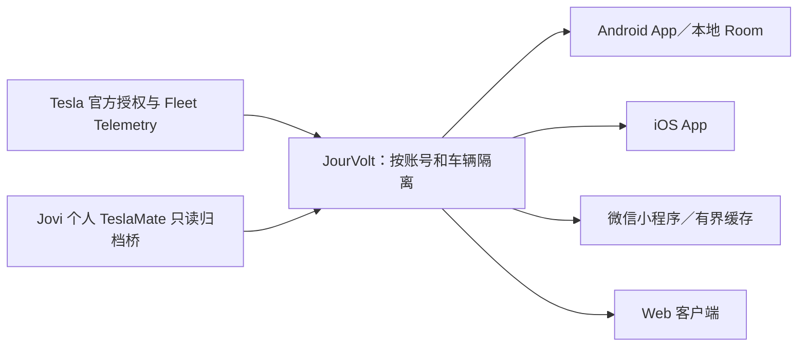

# MateLink 架构与数据流

这是一份导航性合同，不替代接口定义或某个版本的验收结果。当前权威的来源决策见 [Fleet／TeslaMate 混合架构](ARCH-DECISION-2026-09-27-fleet-teslamate-hybrid.md)；[分层存储 ADR](ADR-2026-10-02-tiered-history-storage.md)仍是提案。

## 来源

- 多用户正式新数据走每位用户自己的 Tesla 官方授权、车辆虚拟钥匙和 Fleet Telemetry；TeslaMate 只用于 Jovi 个人已有历史的独立归档，不是共享多用户采集器。
- 登录成功、配置提交、云端接收、历史入库、手机保存和通知送达各有独立证据。没有合格事件就显示未知或等待，不生成行程、充电或胎压历史。
- 不同来源的原始记录保持来源标签及身份，不因为同一数字 ID 或相近时间就自动互相覆盖。详情与汇总采用同一账号、稳定车辆、来源实例／记录和真实时间窗。

## 保存与读取

| 层 | 作用 | 不可据此推断 |
| --- | --- | --- |
| JourVolt 服务端 | 授权、来源归属、接收与有界历史接口；具体保存字段以部署版本和 [接口合同](JOURVOLT-CLOUD-API-CONTRACT.md)为准 | HTTP 200 不等于车辆事件完整、手机已保存或通知已送达 |
| 原生 App | 按账号／车辆隔离的 Room 摘要、合格证据和已下载详情；离线读取必须校验身份、版本和完整度 | 某条摘要存在不等于全部原始点或跨设备备份可恢复 |
| 小程序／Web | 通过相同后端合同读取各自具备权限的数据；小程序仅有有界本地缓存 | 缓存不等于唯一长期档案，也不能伪装成 App 的完整离线能力 |
| 可选冷归档 | 完整详情和换机恢复的候选方向 | 目前不能以提案替代真实备份、恢复或保留期限证明 |

数字 `carId` 仅是某作用域内的接口标识，不是授权凭据。所有派生值保留单位、来源、证据时间、窗口和资格；`null`／未知、真实零、负净回收与估算不能混用。行程能耗、充电费用和统计覆盖必须从同一合格记录计算，不能拿全量里程稀释少数有能量的样本。

## 安全与变更门

- Tesla 密码和 MFA 只进入 Tesla 官方页面；App、Web 和小程序不持有服务端 `client_secret` 或应用私钥。服务端每次按会话核验账号与车辆，TLS、授权和日志脱敏不可为排障降低。
- 读取、归档导入、车辆命令、历史迁移和清理是不同权限。查看诊断页不应触发车辆唤醒或配置写入。
- 变更 Room 或服务端历史结构前，先在隔离副本验证旧版本迁移、断电／取消恢复与真实可恢复备份；旧 APK 文件本身不是数据库回滚。
- 源码通过、CI 通过、模拟器通过、手机安装、自然 Fleet 数据和生产部署分别记录。核查顺序见 [验证与发布门](VALIDATION.md)。

更细的字段、桥接和部署约束分别见 [字段目录](DATA-CATALOG.md)、[TeslaMate 归档桥](TESLAMATE-ARCHIVE-BRIDGE.md)和 [部署操作文档](ARCH-2026-08-28-jourvolt-deploy.md)。
