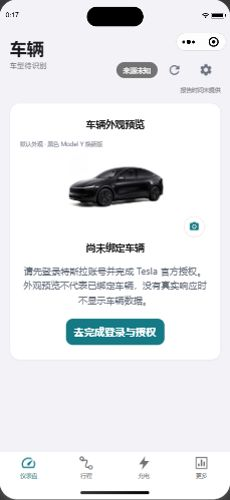
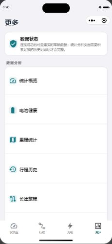
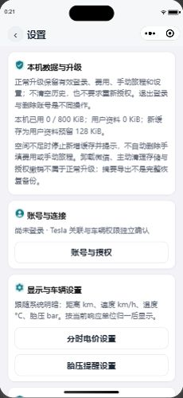
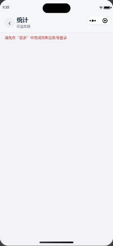

# Tesla_MateLink 微信小程序 UI 现状取证与远端设计交接总案 (Master Handoff Dossier)

> **文档定位**：本文件为 MateLink 微信小程序面向远端 ChatGPT / UI 设计师的**全量一站式交接档案**。
> 本文档包含版本基线、架构路由、各页面真景截图与 ASCII 结构图、现行设计系统 Token 字典、功能状态映射表以及后续设计优化清单。远端设计团队无需反向推测代码或界面，可直接基于本文档开展设计评审与高保真原型重构。

---

## 目录
1. [项目概况与版本基线](#一项目概况与版本基线)
2. [生产环境与网络配置规范](#二生产环境与网络配置规范)
3. [多页面视觉实景证据与解构 (截图汇总)](#三多页面视觉实景证据与解构)
4. [全页面功能清单与状态映射表 (Screen Inventory)](#四全页面功能清单与状态映射表)
5. [现行设计系统完整规范 (Design Tokens)](#五现行设计系统完整规范)
6. [现状痛点与远端设计优化空间 (UI Findings)](#六现状痛点与远端设计优化空间)
7. [面向远端 ChatGPT 的设计交付与工程约束](#七面向远端-chatgpt-的设计交付与工程约束)

---

## 一、项目概况与版本基线

### 1. 基础信息
* **项目代码库**：`Jovifei/tesla-master-mimo`
* **小程序工作目录**：`E:\project\tesla_master\miniprogram_Weixin\miniprogram`
* **技术栈**：`Taro 4.2.1` + `React 18.3.1` + `TypeScript 5.7.3` + `Webpack 5` + `SCSS`
* **当前维护分支**：`codex/miniprogram-e-migration-20261029`
* **源码 Commit SHA**：`4ee0c0479450a27a10e3a845f063e7ddd49f6b23`（状态：`Clean`，已推送到 GitHub 远端）
* **微信小程序 AppID**：`wxc84899ab6146f1be`
* **当前版本号**：`v0.6.7`（已由微信开发者工具 CLI 上传至微信公众平台开发版本列表）
* **历史版本参考**：
  * `v0.6.5`（Commit `799a41c`）：当前线上体验版
  * `v0.6.4`（Commit `0e4cd56`）：审核通过待发布版

### 2. 构建产物与分包预算审计
* **主包体积**：`1,211,664 Bytes` (~1.2 MB，低于微信 2.0MB 门禁上限)
* **车辆模型独立分包**：6 个分包（`vehicle-assets-1` ~ `vehicle-assets-6`），各约 1.5 ~ 1.8 MB
  * 承载 97 张 Tesla 全车系（Model 3/Y/S/X、焕新版 Highland/Juniper、全色系车漆与轮毂）的高保真 3D 渲染透明图。
* **编译产物总包体积**：`11,502,133 Bytes` (~11.0 MB，低于微信 20.0MB 总包上限)
* **产物 SHA-256**：`d9a9d632ec8370a1b119082f38d06b4f12131dc6ba262958fb7376d848aa1eca`
* **自动化单测门禁**：79 个测试文件，994 个单测 **100% PASS**（包含 6 项车辆资产哈希无损校验）。

---

## 二、生产环境与网络配置规范

小程序客户端在构建时已将生产 Cloud API 固化进产物。远端设计与前端交互需严格遵守以下网络边界：

| 配置项 | 确证生产值 | 状态与说明 |
|---|---|---|
| **Cloud API 唯一基准地址** | `https://api.teslalink.joviluma.com/` | `HTTP 200 OK`，实测 `/healthz` 与 `/readyz` 正常响应 |
| **Auth Host (Tesla 授权)** | `auth.teslalink.joviluma.com` | 用于 Tesla 官方 OAuth 授权与 App Link 回调 |
| **生产服务器物理 IP** | `120.55.64.11` | 生产云后端主机 |
| **云 API upstream 端口** | `127.0.0.1:18090` | 服务器内部 Go API 服务监听端口，由 Nginx 反代 |
| **自托管入口** | `https://teslalink.joviluma.com` | **当前返回 502 Bad Gateway (正常预期)**。<br>原因：根据《架构决策路线三》，自托管 Adapter 容器已正常停用，不向外提供服务。小程序**绝不走 18080 自托管入口**。 |
| **绝对禁止的陈旧地址** | `api.jourvolt.com`、`192.168.0.104:18080`、`198.18.x.x` | 历史废弃或局域网/Fake-IP，严禁写入任何代码 |

---

## 三、多页面视觉实景证据与解构

以下截图均为微信开发者工具模拟器（iPhone 14 Pro 视口，393 × 852 pt，DPR 3.0）在未登录/安全测试状态下的真实无损抓取。

### 1. MP-01: 仪表盘主页 (Vehicle Dashboard)
* **路由**：`pages/vehicle/index`（TabBar 1）
* **源码**：[src/pages/vehicle/index.tsx](file:///E:/project/tesla_master/miniprogram_Weixin/miniprogram/src/pages/vehicle/index.tsx)、[index.scss](file:///E:/project/tesla_master/miniprogram_Weixin/miniprogram/src/pages/vehicle/index.scss)
* **截图留档**：`./assets/ui-evidence/01-dashboard.jpg`



```text
+-------------------------------------------------------+
| 0:17                                 [ Dynamic Island ]|
|                                                       |
|  车辆                      [ 来源未知 ]  (刷新) (设置) |
|  车型待识别                                           |
|                                                       |
|  +-------------------------------------------------+  |
|  |                 车辆外观预览                    |  |
|  |   默认外观 · 黑色 Model Y 焕新版                 |  |
|  |                                                 |  |
|  |             [ 黑色 Model Y 3D 渲染图 ]           |  |
|  |                                                 |  |
|  |                                        (相机)   |  |
|  |                   尚未绑定车辆                  |  |
|  |   请先登录特斯拉账号并完成 Tesla 官方授权。     |  |
|  |   外观预览不代表已绑定车辆，没有真实响应时      |  |
|  |   不显示车辆数据。                              |  |
|  |                                                 |  |
|  |            [ 去完成登录与授权 (按钮) ]          |  |
|  +-------------------------------------------------+  |
|                                                       |
| [ 仪表盘* ]       [ 行程 ]       [ 充电 ]      [ 更多 ]|
+-------------------------------------------------------+
```

### 2. MP-02: 行程记录页 (Drives History)
* **路由**：`pages/drives/index`（TabBar 2）
* **源码**：[src/pages/drives/index.tsx](file:///E:/project/tesla_master/miniprogram_Weixin/miniprogram/src/pages/drives/index.tsx)、[index.scss](file:///E:/project/tesla_master/miniprogram_Weixin/miniprogram/src/pages/drives/index.scss)
* **截图留档**：`./assets/ui-evidence/02-drives.jpg`


```text
+-------------------------------------------------------+
| 0:19                                 [ Dynamic Island ]|
|                                                       |
|  行程记录                                             |
|                                                       |
|  +-------------------------------------------------+  |
|  |                     (用户头像图标)               |  |
|  |                 等待特斯拉账号登录              |  |
|  |                                                 |  |
|  |             请先在 “更多” 中建立会话。          |  |
|  +-------------------------------------------------+  |
|                                                       |
|                                                       |
|                                                       |
| [ 仪表盘 ]       [ 行程* ]       [ 充电 ]      [ 更多 ]|
+-------------------------------------------------------+
```

### 3. MP-03: 充电历史页 (Charges History)
* **路由**：`pages/charges/index`（TabBar 3）
* **源码**：[src/pages/charges/index.tsx](file:///E:/project/tesla_master/miniprogram_Weixin/miniprogram/src/pages/charges/index.tsx)、[index.scss](file:///E:/project/tesla_master/miniprogram_Weixin/miniprogram/src/pages/charges/index.scss)
* **截图留档**：`./assets/ui-evidence/03-charges.jpg`


```text
+-------------------------------------------------------+
| 0:19                                 [ Dynamic Island ]|
|                                                       |
|  充电历史                                             |
|                                                       |
|  +-------------------------------------------------+  |
|  |                     (用户头像图标)               |  |
|  |                 等待特斯拉账号登录              |  |
|  |                                                 |  |
|  |             请先在 “更多” 中登录特斯拉账号。     |  |
|  +-------------------------------------------------+  |
|                                                       |
|                                                       |
|                                                       |
| [ 仪表盘 ]       [ 行程 ]       [ 充电* ]      [ 更多 ]|
+-------------------------------------------------------+
```

### 4. MP-04: 更多设置页 (More & Settings)
* **路由**：`pages/me/index`（TabBar 4）
* **源码**：[src/pages/me/index.tsx](file:///E:/project/tesla_master/miniprogram_Weixin/miniprogram/src/pages/me/index.tsx)、[index.scss](file:///E:/project/tesla_master/miniprogram_Weixin/miniprogram/src/pages/me/index.scss)
* **截图留档**：`./assets/ui-evidence/04-more.jpg`



```text
+-------------------------------------------------------+
| 0:20                                 [ Dynamic Island ]|
|                                                       |
|  更多                                                 |
|                                                       |
|  +-------------------------------------------------+  |
|  | (盾牌图标) 数据状态                              |  |
|  | 连接成功后可查看实时车辆数据；统计分析页面需要累 |  |
|  | 积足够的历史记录后才会完整。                     |  |
|  +-------------------------------------------------+  |
|                                                       |
|  数据分析                                             |
|  +-------------------------------------------------+  |
|  | (表盘图标) 统计概览                             >|  |
|  | ----------------------------------------------- |  |
|  | (电池图标) 电池健康                             >|  |
|  | ----------------------------------------------- |  |
|  | (地图图标) 里程统计                             >|  |
|  | ----------------------------------------------- |  |
|  | (历史图标) 行程历史                             >|  |
|  | ----------------------------------------------- |  |
|  | (轨迹图标) 长途旅程                             >|  |
|  +-------------------------------------------------+  |
|                                                       |
| [ 仪表盘 ]       [ 行程 ]       [ 充电 ]      [ 更多* ]|
+-------------------------------------------------------+
```

### 5. MP-05: 设置与工具页 (Tools & Tariffs)
* **路由**：`pages/tools/index`（从“更多”跳转）
* **源码**：[src/pages/tools/index.tsx](file:///E:/project/tesla_master/miniprogram_Weixin/miniprogram/src/pages/tools/index.tsx)、[index.scss](file:///E:/project/tesla_master/miniprogram_Weixin/miniprogram/src/pages/tools/index.scss)
* **截图留档**：`./assets/ui-evidence/05-tools.jpg`



```text
+-------------------------------------------------------+
| 0:21                                 [ Dynamic Island ]|
|  < 设置                                               |
|                                                       |
|  +-------------------------------------------------+  |
|  | (勾选盾牌) 本机数据与升级                        |  |
|  | 正常升级保留有效登录、费用、手动旅程和设置...    |  |
|  | 本机已用 0 / 800 KiB; 用户资料 0 KiB; 新缓存为用 |  |
|  | 户资料预留 128 KiB。                             |  |
|  | 空间不足时停止新增缓存并提示...                 |  |
|  +-------------------------------------------------+  |
|                                                       |
|  +-------------------------------------------------+  |
|  | (用户图标) 账号与连接                            |  |
|  | 尚未登录 · Tesla 关联与车辆权限独立确认           |  |
|  |            [ 账号与授权 (二级按钮) ]             |  |
|  +-------------------------------------------------+  |
|                                                       |
|  +-------------------------------------------------+  |
|  | (齿轮图标) 显示与车辆设置                        |  |
|  | 跟随系统明暗；距离 km、速度 km/h、温度 °C、胎压   |  |
|  | bar。按当前响应单位归一后显示。                  |  |
|  |            [ 分时电价设置 (按钮) ]               |  |
|  |            [ 胎压提醒设置 (按钮) ]               |  |
|  +-------------------------------------------------+  |
+-------------------------------------------------------+
```

### 6. MP-06: 统计分析页 (Analysis Summary)
* **路由**：`pages/analysis/index`（从“更多”中的“统计概览”跳转）
* **源码**：[src/pages/analysis/index.tsx](file:///E:/project/tesla_master/miniprogram_Weixin/miniprogram/src/pages/analysis/index.tsx)
* **截图留档**：`./assets/ui-evidence/06-analysis.jpg`



```text
+-------------------------------------------------------+
| 0:22                                 [ Dynamic Island ]|
|  < 统计                                               |
|    所选车辆                                           |
|                                                       |
|  请先在 “更多” 中完成特斯拉账号登录 (红字提示)        |
|                                                       |
|                                                       |
+-------------------------------------------------------+
```

### 7. 微信公众平台体验版二维码 (v0.6.7)
* **截图留档**：`./assets/ui-evidence/v067-preview-qr.png`
* 供真机微信扫码直接体验当前构建（需开发者或体验成员权限）。


---

## 四、全页面功能清单与状态映射表

| Screen ID | 页面名称 | 路由路径 | 核心用户任务 | 核心数据字段与单位 | 支持状态覆盖 |
|---|---|---|---|---|---|
| **MP-01** | **仪表盘** | `pages/vehicle/index` | 查看车辆状态、剩余电量、估算续航、换色预览、控制抽屉 | `SOC %`, `续航 km`, `内外温 °C`, `胎压 bar/psi`, `里程 km` | • 未绑定态 (当前展示)<br>• 在线正常态<br>• 休眠态 (不唤醒)<br>• 离线缓存态 |
| **MP-02** | **行程记录** | `pages/drives/index` | 驾驶历史查询、起止地逆编码、单次行程能耗 | `行驶里程 km`, `能耗 Wh/km`, `用时 min`, `极速 km/h` | • 未登录态<br>• 空数据态<br>• 列表下拉刷新<br>• 上拉分页 (20条/页) |
| **MP-03** | **充电历史** | `pages/charges/index` | 充电事件追踪、分时电价折算、充入度数与金额 | `充入量 kWh`, `最大功率 kW`, `起止 SOC %`, `费用 ￥` | • 未登录态<br>• 充电中态 (动态)<br>• 手动账单覆盖态<br>• 空历史态 |
| **MP-04** | **更多** | `pages/me/index` | 系统总览、数据分析路由导航、账号绑定、版本查看 | 同步状态、账号名称、绑定微信 OpenID 状态 | • Inset Grouped 分组卡片<br>• 微信快速解绑/绑定弹窗 |
| **MP-05** | **设置与工具** | `pages/tools/index` | 存储配额监控、分时电价配置、胎压提醒阈值 | `缓存使用量 KiB / 800KiB`, `峰平谷时段与单价 ￥/kWh` | • 本地缓存配额警戒<br>• 电价表单编辑<br>• 恢复默认规则 |
| **MP-06** | **统计分析** | `pages/analysis/index` | 能耗趋势图、月度对比、百公里电耗散点分布 | `总能耗 kWh`, `平均能耗 Wh/km`, `月度里程 km` | • 未登录拦截<br>• 样本量不足提示<br>• 图表骨架态 |
| **MP-07** | **行程洞察** | `pages/insights/index` | 电池健康衰减、实际达成率对比、长途分段分析 | `电池衰减 %`, `标称 vs 实际达成率 %`, `路段能耗` | • 参数分流加载 (`kind=battery/range/cost/longTrips`) |
| **MP-08** | **账号与授权** | `pages/auth/index` | Tesla 官方 OAuth 授权中转、Claim 事务认领 | 授权 Transaction ID, 临时 Proof 凭证 | • 官方安全 WebView<br>• 授权超时/取消处理<br>• 成功回跳 |
| **MP-09** | **法律条款** | `pages/legal/index` | 查看服务条款、隐私政策、非特斯拉官方声明 | 协议版本号、更新日期、合规章节 | • 静态文档展示 (`kind=terms/privacy`) |
| **COMP-01** | **车漆轮毂选择器** | `AppearanceSelector` | 选择车身外观、轮毂样式、高保真渲染切换 | 车型 (`3/Y/S/X`)、车漆代码 (`PBSB/PPSW等`)、轮毂代码 | • 浮层 Drawer<br>• 97 张图片资源预加载 |
| **COMP-02** | **胎压监控面板** | `TpmsPanel` | 四轮胎压实时显示、高低压警示、单位切换 | `左前/右前/左后/右后 bar 或 psi`, `更新时间` | • 正常态 (绿)<br>• 报警态 (黄/红)<br>• 离线缓存时间提示 |

---

## 五、现行设计系统完整规范 (Design Tokens)

源码对应文件：[src/styles/apple-tokens.scss](file:///E:/project/tesla_master/miniprogram_Weixin/miniprogram/src/styles/apple-tokens.scss)。

### 1. 色彩映射表 (Light / Dark 规范)

```scss
/* 核心背景与表面 */
--apple-bg:                #f2f2f7;   /* [Dark] #000000 */
--apple-surface:           #ffffff;   /* [Dark] #1c1c1e (卡片主表面) */
--apple-surface-secondary: #f7f7f9;   /* [Dark] #2c2c2e (次级凹陷或输入底色) */
--apple-surface-tertiary:  #ebebf0;   /* [Dark] #3a3a3c */

/* 文字阶梯 (Typography Colors) */
--apple-label-primary:     #1c1c1e;   /* [Dark] #ffffff (高强调标题) */
--apple-label-secondary:   #6e6e73;   /* [Dark] #8e8e93 (次要文字与正文) */
--apple-label-tertiary:    #8e8e93;   /* [Dark] #636366 (占位符与单位) */
--apple-label-quaternary:  #aeaeb2;   /* [Dark] #48484a */

/* 品牌与语义色 (Brand & Semantics) */
--apple-teal:              #157a86;   /* [Dark] #2cb5c4 (MateLink 品牌主色，按钮与 TabBar) */
--apple-teal-soft:         rgba(21, 122, 134, 0.10);
--apple-tint:              #0071e3;   /* [Dark] #0a84ff (Apple 系统强调蓝) */
--apple-success:           #34c759;   /* [Dark] #30d158 (在线/正常/充电正常) */
--apple-warning:           #ff9500;   /* [Dark] #ff9f0a (电量过低/胎压报警) */
--apple-error:             #ff3b30;   /* [Dark] #ff453a (离线错误/阻断) */

/* 分割线与边框 */
--apple-separator:         rgba(60, 60, 67, 0.12); /* [Dark] rgba(235, 235, 245, 0.14) */
--apple-separator-opaque:  #e5e5ea;                /* [Dark] #38383a */
```

### 2. 空间与曲率系统 (Spacing & Radius)

```scss
/* 间距刻度 (以微信 rpx 计，750rpx = 375pt) */
--apple-spacing-2xs:  8rpx;   /* 4px */
--apple-spacing-xs:  12rpx;   /* 6px */
--apple-spacing-sm:  16rpx;   /* 8px */
--apple-spacing-md:  24rpx;   /* 12px */
--apple-spacing-lg:  32rpx;   /* 16px */
--apple-spacing-xl:  40rpx;   /* 20px */
--apple-spacing-2xl: 48rpx;   /* 24px */

/* 连续曲率圆角 (Continuous Squircle) */
--apple-radius-xs:    8rpx;   /* 4px - 标签 Badge */
--apple-radius-sm:   14rpx;   /* 7px - 小型控件 */
--apple-radius-md:   20rpx;   /* 10px - 主操作按钮 */
--apple-radius-card: 28rpx;   /* 14px - Inset Grouped 卡片外框 */
--apple-radius-large:36rpx;   /* 18px - 大弹窗与 Sheet */
--apple-radius-pill: 999rpx;  /* 胶囊形状 */
```

### 3. 字体与排版特性 (Typography & Tabular Numbers)
* **字体栈**：优先使用系统苹方 `-apple-system, BlinkMacSystemFont, "SF Pro Text", "PingFang SC", sans-serif`。
* **等宽数字强制要求**：
  ```scss
  font-feature-settings: "tnum" 1, "cv01" 1;
  font-variant-numeric: tabular-nums;
  ```
  所有涉及里程、速度、能耗、时间与电价的动态数值组件（[src/components/MetricValue.tsx](file:///E:/project/tesla_master/miniprogram_Weixin/miniprogram/src/components/MetricValue.tsx)）必须启用等宽，防止数值刷新变动时引起布局震颤。

---

## 六、现状痛点与远端设计优化空间 (UI Findings)

经独立代码审查与模拟器实测，当前 UI 架构稳定，但在视觉表现与用户体验上有明确的升级空间。请远端设计师重点评审以下 4 个方向：

### 1. [P0 优先级] 未登录/未绑定车辆时的“空态”视觉引导过弱
* **现状观察**：
  * 在行程、充电、统计页面中（见截图 `02-drives.jpg`、`03-charges.jpg`、`06-analysis.jpg`），未登录状态仅有一个小圆形头像图标与两行文字，大面积灰底空白，视觉非常空洞。
* **用户体验影响**：
  * 初次进入小程序的用户无法预知“连接车辆后我将得到怎样的体验”，转化引导缺乏吸引力。
* **远端设计优化方向**：
  * 设计具有高级感与品牌质感的 **Apple 风格骨架/插画空态（Preview Empty State）**。
  * 例如：在半透明毛玻璃背景上显示淡化的示例行程曲线、能耗热力图或充电里程柱状图剪影，并附带明确的操作指引卡片：“连接您的 Tesla，解锁每一次出行的精准能耗洞察”。

### 2. [P1 优先级] 仪表盘（Dashboard）在小屏设备下的卡片信息密度与层级
* **现状观察**：
  * 在未绑定状态下，外观卡片和登录提示卡片纵向堆叠，在 iPhone SE（375pt）或部分安卓窄屏上，卡片底部按钮几乎贴紧 TabBar。
  * 真实绑定车辆后，空调、前后备箱、闪灯鸣笛等 4 个控制按钮采用传统横排按钮布局，文字字号容易被挤压。
* **远端设计优化方向**：
  * 将核心数据指标（电量百分比、续航里程、车内外温度、胎压）设计为 **iOS 灵动微件卡片（Widgets Grid）**。
  * 将控制按钮重构为 2×2 网格或横向滑动的微型快捷控制胶囊，突出图标本身，支持触觉触控反馈（Haptic feedback 提示）。

### 3. [P1 优先级] 数据分析（Analysis & Insights）的数据可视化表达欠缺
* **现状观察**：
  * 当前小程序底层具备完整的算法引擎（百公里能耗散点、分时电价区间计算、电池健康度模型），但在前端展现上多为密集的文本与数据清单（见 `06-analysis.jpg`）。
* **远端设计优化方向**：
  * 引入类似 **Apple Fitness / Health** 的现代极简可视化组件：
    * 环形电量与能效进度指示环（Activity Rings 风格）。
    * 极简 24 小时峰谷电价充放电分布柱状图（Bar Chart）。
    * 极简折线微图（Sparkline），展示行程过程中的坡度与电耗起伏。

### 4. [P2 优先级] 深色模式（Dark Mode）局部细节的一致性
* **现状观察**：
  * 核心 Token 虽然覆盖了深色模式，但部分历史二级弹窗与次级文字（如法务声明尾注、逆地理编码状态）仍有硬编码十六进制色值的情况。
* **远端设计优化方向**：
  * 彻底清除全局 SCSS 中任何未参数化的颜色，保证所有组件均严格绑定 `--apple-*` 语义变量，在微信深色模式下 100% 严丝合缝。

---

## 七、面向远端 ChatGPT 的设计交付与工程约束

为了保证远端设计方案能够被本地工程无缝采纳并直接落实为代码，请远端团队遵循以下工程约束：

1. **单位与布局约束**：
   * 微信小程序样式采用 `rpx`（基准为 750rpx 对应 375pt 设计稿，即 `1px = 2rpx`）。
   * 采用弹性盒（Flexbox）与 CSS Grid，严禁使用超出屏幕的绝对定位。
2. **包体积与组件依赖约束**：
   * 小程序受到微信主包 2.0MB 的强制限制，**严禁引入重量级外部 UI 库（如完整 AntD Mobile、Vant 等）或庞大的 ECharts 依赖**。
   * 图表与可视化建议采用轻量级原生 `<Canvas>` 实现或纯 CSS/SVG 绘制。
3. **分包素材调度规范**：
   * 车辆素材必须使用既有的 `vehicle-assets-1` ~ `6` 异步分包加载机制，严禁在主包中直接 `import` 高清车身底图。
4. **输出物要求**：
   * 远端交付设计方案时，建议提供：
     1. **页面整体视觉排版结构说明与卡片分区**；
     2. **关键 SCSS 样式块或 Design Tokens 扩展定义**；
     3. **React/Taro 组件结构伪代码与 Props 接口定义**。

---
*本案由本地工程基于分支 `codex/miniprogram-e-migration-20261029` 自动生成，所有截图与参数均与当前运行中的微信开发者工具及构建产物实景严格对齐。*
