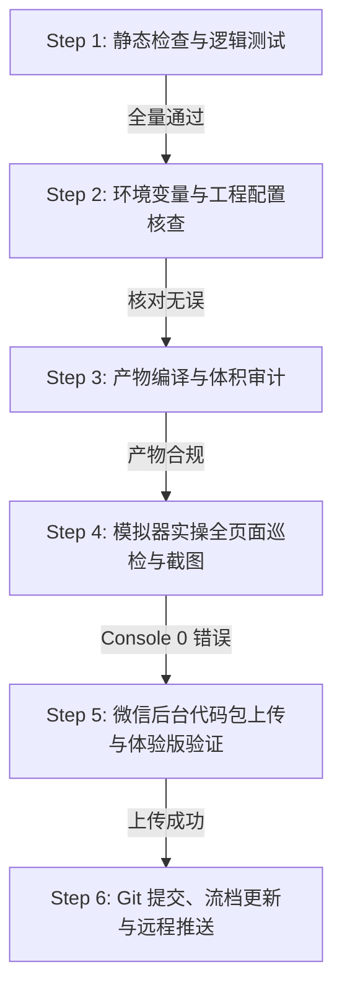

# MateLink 车迹小程序项目提交与发布备忘录 (Submission Playbook)

> **前置必读**：执行本备忘录前，必须已阅读 [PROJECT-REQUIREMENTS.md](file:///E:/project/tesla_master/miniprogram_Weixin/docs/PROJECT-REQUIREMENTS.md)。
> **流程原则**：严格执行门禁检查，步骤不跳过、不折损。所有步骤必须通过后方可执行 Git 提交与微信后台上传。



---

## 阶段一：静态代码检查与单测门禁

在 `miniprogram/` 目录下依次运行并核对：

### 1. TypeScript 类型检查
```powershell
cd E:\project\tesla_master\miniprogram_Weixin\miniprogram
npm run typecheck
```
* **合格判据**：退出码为 `0`，没有任何类型报错 (`tsc --noEmit` 0 errors)。

### 2. 单元测试与资源完整性验证
```powershell
npm test
```
* **合格判据**：
  * 6 项车辆资产原始 PNG 哈希与尺寸校验（`vehicle-assets-integrity.test.mjs`）全部通过。
  * 79 个测试文件、990+ 项单测全部通过（`Tests 100% passed`，0 fail）。

---

## 阶段二：配置审查与环境变量固化

在构建前，必须核验以下两个关键配置文件：

### 1. 核对 `project.config.json`
检查 [miniprogram/project.config.json](file:///E:/project/tesla_master/miniprogram_Weixin/miniprogram/project.config.json)：
* 必须显式声明：`"miniprogramRoot": "dist/"`
* 必须确认 AppID：`"appid": "wxc84899ab6146f1be"`
* 必须确认项目名：`"projectname": "MateLink车迹"`

### 2. 核对 API 环境变量与兜底配置
检查 [miniprogram/config/index.ts](file:///E:/project/tesla_master/miniprogram_Weixin/miniprogram/config/index.ts)：
* 检查 `apiBaseUrl` 声明是否包含正确的生产兜底：
  ```ts
  const apiBaseUrl = process.env.TARO_APP_API_BASE_URL || 'https://api.teslalink.joviluma.com/'
  ```
* 检查 `miniprogram/.env` 中是否存在：
  ```text
  TARO_APP_API_BASE_URL=https://api.teslalink.joviluma.com/
  ```

---

## 阶段三：编译打包与产物审计

### 1. 执行生产打包
```powershell
npm run build:weapp
```

### 2. 产物体积与分包预算审计
检查编译输出，必须满足微信小程序规范：
* **主包体积**：`≤ 2.0 MB`（当前实测约 1.2 MB）。
* **分包体积**：每个独立分包 `≤ 2.0 MB`（6 个车辆分包各约 1.5 ~ 1.8 MB）。
* **总包体积**：`≤ 20.0 MB`（当前实测约 11.0 MB）。
* **产物编译常量核查**：运行以下指令验证 API 地址是否已真实打入产物：
  ```powershell
  node -e "const c = require('fs').readFileSync('dist/common.js','utf8'); if(!c.includes('https://api.teslalink.joviluma.com/')) { throw new Error('API 地址未打入产物！'); } console.log('API 地址打入验证通过');"
  ```

---

## 阶段四：微信开发者工具模拟器启动与全页面巡检

> **核心红线**：严禁不上模拟器就直接提审！必须通过自动化工具进行真景巡检。

### 1. 启动微信开发者工具项目窗口
```powershell
& "E:\AI_Tools\Other\WeChatDevTools\cli.bat" open --project "E:\project\tesla_master\miniprogram_Weixin\miniprogram"
```

### 2. 控制台日志排查（Console Error 必须为 0）
```powershell
$token = (Get-Content "C:\Users\Admin\AppData\Local\微信开发者工具\User Data\6415b9ce39988491068e4d787211d913\Default\mcp.json" | ConvertFrom-Json).mcpServers.'wechat-devtools'.args[1].Split('=')[1]
& "E:\AI_Tools\Other\WeChatDevTools\wechatide.cmd" -c cli get_simulator_console --project "E:\project\tesla_master\miniprogram_Weixin\miniprogram" --command "grep -i error" --token=$token
```
* **合格判据**：输出 `"result": ""`，控制台无任何未捕获异常。

### 3. 逐页打开并截屏抽检
依次执行打开并截取各主要页面，目视确认 UI 排版完整，无样式错位或白屏：
1. **仪表盘**：`pages/vehicle/index`
2. **行程记录**：`pages/drives/index`
3. **充电历史**：`pages/charges/index`
4. **更多 (设置)**：`pages/me/index`
5. **电价与设置工具**：`pages/tools/index`
6. **统计分析**：`pages/analysis/index`

截屏命令示例：
```powershell
& "E:\AI_Tools\Other\WeChatDevTools\wechatide.cmd" -c cli simulator_open_page --project "E:\project\tesla_master\miniprogram_Weixin\miniprogram" --page "pages/vehicle/index" --token=$token
Start-Sleep -Seconds 2
& "E:\AI_Tools\Other\WeChatDevTools\wechatide.cmd" -c cli simulator_screenshot --project "E:\project\tesla_master\miniprogram_Weixin\miniprogram" --token=$token --path "C:\Users\Admin\.gemini\antigravity\brain\<conversation-id>\simulator_page_vehicle.jpg"
```

---

## 阶段五：微信后台上传与体验版发布

### 1. 上传代码至微信公众平台
确保 `package.json` 中的 `version` 已经根据发布类型（语义化版本，如 `0.6.7`）更新：
```powershell
$version = (Get-Content "package.json" | ConvertFrom-Json).version
$head = (git rev-parse --short HEAD).Trim()
$desc = "v$version ($head) 包含功能简述与更新说明"
& "E:\AI_Tools\Other\WeChatDevTools\cli.bat" upload --project "E:\project\tesla_master\miniprogram_Weixin\miniprogram" -v $version -d $desc
```
* **合格判据**：CLI 返回 `√ upload`，并输出分包体积表格。

### 2. 生成预览二维码并自测
```powershell
& "E:\AI_Tools\Other\WeChatDevTools\cli.bat" preview --project "E:\project\tesla_master\miniprogram_Weixin\miniprogram" --qr-format image --qr-output "preview_qr.png"
```

---

## 阶段六：Git 提交规范与流档台账更新

1. **更新台账**：在 [docs/SUBMISSION-INDEX.md](file:///E:/project/tesla_master/miniprogram_Weixin/docs/SUBMISSION-INDEX.md) 中追加本次版本的详细流档。
2. **Git 差异审查**：
   ```powershell
   git status --short --branch
   git diff --check
   ```
3. **显式添加并提交**：
   ```powershell
   git add <修改文件清单>
   git commit -m "feat/fix(miniprogram): 版本更新与功能说明"
   git push origin <当前分支>
   ```
4. **生成验收交付报告**：向 Jovi 汇报本次版本号、Git SHA、测试结果、截图证据及体验版状态。
